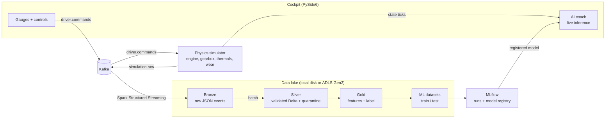

# Virtual Vehicle Diagnostics

An end-to-end streaming data platform built around a physics-based car simulator:
telemetry is streamed through **Kafka** into a **Spark / Delta Lake medallion architecture**
(Bronze → Silver → Gold), turned into ML features, used to train a **scikit-learn** model tracked
in **MLflow**, and scored live back in the driver's cockpit.


## Architecture



| Step | Code | What happens |
| :--- | :--- | :--- |
| Simulation | `simulator/` | 10 Hz physics loop: torque curve, gear shifts, drag and rolling resistance, coolant/oil temperatures, engine wear. Car, driver and world behaviour come from YAML profiles. |
| Streaming | `streaming/`, `infra/kafka/` | Every tick is published as a versioned `simulation.raw` event; cockpit inputs travel the other way as `driver.commands`. |
| Bronze | `pipelines/processor/bronze_processor.py` | Spark Structured Streaming from Kafka, raw events stored as JSON with checkpointing. |
| Silver | `pipelines/processor/silver_processor.py` | Explicit schema, flattening, null and physical-range checks, de-duplication per tick. Invalid rows go to a quarantine table; data quality counts are appended to a metrics table. |
| Gold | `pipelines/processor/gold_processor.py` | 10-second rolling features per session and the wear-rate label (see below). |
| ML | `ml/` | Group split by `simulation_id` (no leakage between sessions), Random Forest training, metrics, feature importance and model registration in MLflow. |
| Live inference | `ml/inference/inference_processor.py` | The cockpit keeps the last 10 seconds of ticks and scores them with the registered model every second. |

## The ML problem: a virtual wear sensor

A real car cannot measure how fast its engine is wearing, but it can measure RPM, load, throttle and
temperatures. The model is a **virtual sensor**: from those observable signals it estimates whether the
current driving is wearing the engine abnormally fast, and the cockpit's AI coach warns the driver live.

- **Features** (last 10 s, `ml/datasets/feature_config.py`): average / std / range / max of RPM, average throttle,
  average and max engine load, power factor (RPM × load), speed, gear and oil temperature.
- **Label:** engine wear accumulated over the same 10 s, taken from the simulator's wear model. Windows above the
  75th percentile of that wear rate are `AGGRESSIVE`, the rest `NORMAL`. Wear itself is never a feature.
- **Train/serve parity:** the Gold layer (Spark window functions) and the live engine (pandas) compute the
  features from one shared definition, and a test checks that both produce identical values.
- **No leakage between sessions:** train and test are split by `simulation_id`, never by row.
- **Evaluation:** besides accuracy, every run logs a majority-class baseline, F1 for `AGGRESSIVE` and ROC-AUC.
  With a ~25 % positive class, "always NORMAL" already scores ~75–80 % accuracy, so accuracy alone says little.


### Results

`generate_sessions.py --sessions 12 --minutes 3` (eco / normal / sport, Ford Focus and Lamborghini; seeded, so the
same command reproduces the same data and split), split by session into 14 400 training and 4 800 test rows:

| Metric | Model | Baseline (always `NORMAL`) |
| :--- | ---: | ---: |
| Accuracy | 0.90 | 0.81 |
| F1 `AGGRESSIVE` | 0.67 | 0.00 |
| ROC-AUC | 0.97 | 0.50 |

With 30 sessions the model keeps a similar margin (accuracy 0.88 vs 0.77 baseline, ROC-AUC 0.92).
Most important features: oil temperature, average RPM and average engine load (cold-engine load is the main source of wear in the simulator).

**What did not work first:** the label originally described wear over the *next* 10 seconds. In the simulator,
wear depends almost entirely on the current load, oil temperature and RPM, while the next 10 seconds depend on
what the driver does with the pedal, so the forecast barely beat the baseline (ROC-AUC 0.65–0.75 depending on
the split). Estimating the wear of the current window is both answerable from the data and what the coach needs.

## Run it locally

Everything runs on one machine; Azure is optional.

**Prerequisites:** Python 3.12, Java 17 or 21 (for Spark 3.5), Docker (for Kafka).
On Windows, Spark also needs `winutils.exe` and `hadoop.dll` in `%HADOOP_HOME%\bin`.

```bash
# 1. Kafka + Kafka UI (http://localhost:8080)
docker compose -f infra/kafka/docker-compose.yml up -d

# 2. Python environment
python -m venv .venv
source .venv/bin/activate          # Windows: .venv\Scripts\activate
pip install -r requirements.txt
cp .env.example .env               # optional, defaults are local

# 3. Produce telemetry: drive the cockpit yourself...
python app/runtimes/main.py
#    ...or generate a batch of eco / normal / sport sessions headless
python app/runtimes/generate_sessions.py --sessions 12 --minutes 3

# 4. Bronze -> Silver -> Gold
python app/runtimes/run_pipelines.py

# 5. Gold -> train/test -> model (registered in MLflow as driving_style_classifier)
python app/runtimes/run_ml_datasets.py
mlflow ui --backend-store-uri sqlite:///mlflow.db   # browse runs at http://localhost:5000

# 6. Start the cockpit again: the AI coach now loads the latest registered model
python app/runtimes/main.py
```

**Cockpit controls:** mouse wheel = throttle, Shift + mouse wheel = brake. The car and driver profile are chosen
before pressing START. Without a trained model the cockpit still runs; only the AI coach is disabled.

The first Spark start downloads the Delta and Kafka connectors from Maven
(set `SPARK_JARS_DIR` to use pre-downloaded jars instead). Data lands in `./data/lake/<layer>`.

### Configuration

All settings live in `app/app_config.py` and can be overridden with environment variables or `.env`:

| Variable | Default | Purpose |
| :--- | :--- | :--- |
| `KAFKA_BROKERS` | `localhost:9092` | Kafka bootstrap servers |
| `STORAGE_MODE` | `local` | `local` (writes to `LOCAL_LAKE_DIR`) or `azure` (ADLS Gen2 over `abfss://`) |
| `LOCAL_LAKE_DIR` | `./data/lake` | Root of the local data lake |
| `AZURE_STORAGE_ACCOUNT`, `AZURE_STORAGE_KEY` | – | Required with `STORAGE_MODE=azure` |
| `SPARK_MASTER` | `local[*]` | Spark master URL |
| `MLFLOW_TRACKING_URI` | `sqlite:///mlflow.db` | MLflow tracking store |
| `MODEL_URI` | `models:/driving_style_classifier/latest` | Model served by the cockpit |
| `VVD_DEBUG` | – | `1` prints every simulation tick |

## Tests

```bash
pytest
```

- `tests/test_simulation.py` – every car profile drives, ticks are consecutive immutable snapshots, wear never decreases, telemetry stays within the Silver quality ranges.
- `tests/test_inference.py` – live feature computation and the warm-up window.
- `tests/test_spark_pipeline.py` – Bronze JSON → Silver → Gold on a simulated session: de-duplication, quarantine, both label classes, and **feature parity between Gold and live inference** (skipped without Java).

## Project structure

```
app/            configuration and entry points (cockpit, data generator, pipelines, ML)
infra/          Kafka client + docker-compose, Spark session factory
simulator/      physics modules, profile loaders, simulation loop, YAML profiles
streaming/      event models, Kafka producers and consumers
pipelines/      Bronze / Silver / Gold processors (template-method base class)
ml/             feature config, dataset + split processors, training, MLflow setup, live inference
ui2/            PySide6 cockpit and widgets
tests/          pytest suite
```

## Design notes

- **Separation of concerns:** the simulator knows nothing about Kafka or Spark; it publishes ticks on an in-process state bus, and adapters forward them.
- **Template method:** every batch step is a `BaseProcessor` (`read → transform → process → write`), so pipelines read the same way.
- **Idempotent batch layers:** Silver and Gold are rebuilt from the layer below with `overwrite`, so re-running a pipeline never duplicates data. Bronze is append-only with a streaming checkpoint.
- **Data quality as data:** rejected rows are kept in quarantine and quality counts are stored per run, instead of being dropped silently.
- **Thread safety:** the physics loop runs on its own thread and hands ticks to the Qt GUI thread through signals.

## Known limitations

- **Simulated ground truth:** the label comes from the simulator's wear formula (cold-engine load, overheating,
  high RPM), so the model learns that formula rather than real engine physics.
- **Relative threshold:** the label is the top 25 % of wear rates in the whole dataset, so the share of
  `AGGRESSIVE` windows is fixed by construction rather than by an absolute wear limit.
- **Small evaluation set:** with 12 sessions the test set holds 3 of them; generate more sessions for steadier metrics.
- The cockpit's AI coach and the Spark ingestion run in the same process as the UI; in production they would be separate services.

## Roadmap

- Analytics dashboard (Streamlit) over Silver/Gold: session replay, model quality, data quality metrics.
- Data quality rules with Great Expectations as the gate between Bronze and Silver.
- Per-driver evaluation, and a regression model for the wear rate instead of two classes.
- CI: run the pytest suite (including the Spark tests) on every push.

## Tech stack

Python 3.12 · PySide6 · Apache Kafka · Apache Spark 3.5 (Structured Streaming + batch) · Delta Lake ·
Azure Data Lake Gen2 (optional) · scikit-learn · MLflow · pytest · Docker
